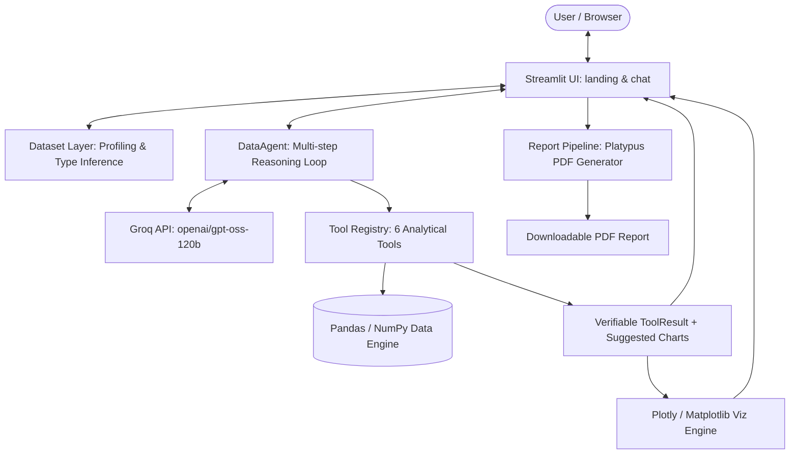

An intelligent, agentic Data Analysis application built with Streamlit and powered by Groq (`openai/gpt-oss-120b`). Upload any tabular dataset (CSV or Excel), interact with an autonomous analytical agent in a natural-language chat interface, view interactive Plotly visualizations, inspect verifiable computation traces, and export professional PDF reports.

---

## 1. Stack & Architecture

| Layer | Choice | Rationale |
|---|---|---|
| **UI** | Streamlit + Custom Glassmorphism CSS | Rapid interactive data UI with fluid animations, mobile-first responsiveness, and inline SVG icons. |
| **LLM Provider** | Groq API (`openai/gpt-oss-120b`) | Ultra-fast inference latency with native tool/function calling support. |
| **Data & Math** | Pandas, NumPy, SciPy | Deterministic computation engine. The LLM never computes or fabricates numbers. |
| **Interactive Charts** | Plotly (`plotly.express`) | Dynamic dark-themed charts with hover telemetry and automatic sampling. |
| **PDF Graphics** | Matplotlib / Seaborn | Server-side vector-rendered figures for crisp printable reports. |
| **PDF Assembly** | ReportLab Platypus | Multi-page publication-quality reporting with running headers, footers, and zebra tables. |
| **Validation** | Pydantic v2 | Strict JSON schema generation and argument validation across all tools and chart specs. |
| **Tests** | Pytest (`streamlit.testing.v1.AppTest`) | 100% test coverage across datasets, tools, viz engines, agent routing, and UI. |

### Architecture Diagram



---

## 2. Tool Distinctness Table (§5.8)

The system features 6 genuinely distinct analytical tools. No tool duplicates another's functionality:

| Tool Name | Question Type | Pandas / NumPy Operation | Output Type |
|---|---|---|---|
| `filter_data` | Selection & Search | Boolean indexing (`==, !=, >, <, in, between, contains`), projection, sorting | Filtered row subset (JSON table + row counts) |
| `statistical_analysis` | Descriptive Stats & Spread | `describe()`, quantiles, IQR, variance, skew, kurtosis, mode | Statistical summary dictionary + box/hist data |
| `aggregate_data` | Grouping & Comparison | `groupby().agg({col: [sum, mean, ...]})`, pivot calculations | Multi-dimensional aggregation table + bar chart data |
| `correlation_analysis` | Pairwise Relationships | `df.corr(method="pearson"/"spearman")`, strength ranking | Correlation matrix, top ranked pairs + scatter/heatmap data |
| `outlier_detection` | Anomaly Screening | IQR bounds ($Q_1 - 1.5 \cdot IQR$) & Z-score ($z > 3.0$) | Upper/lower cutoffs, outlier count/% + anomaly table |
| `time_series_analysis` | Temporal Dynamics & Trends | `pd.to_datetime`, chronological sorting, `resample()`, `polyfit` slope | Period changes, trend slope/direction + line chart data |

---

## 3. Persistent Memory
    The application includes a persistent long-term memory system (`backend/memory/`) backed by **Supabase PostgreSQL**. Instead of saving raw datasets or full chat transcripts, the agent selectively identifies, normalizes, deduplicates, and stores reusable knowledge across sessions:

- **Preferences:** e.g., *"Remember that I always prefer median instead of mean"* or *"Prefer weekly summaries over daily summaries."*
- **Domain Knowledge & Metric Definitions:** e.g., *"Remember that Active customers excludes cancelled accounts."*
- **Corrections:** e.g., *"Actually, active customers excludes both cancelled and trial accounts"* (updates the existing memory in-place instead of creating duplicates).
- **Reusable Filter Rules & Instructions:** e.g., *"Remember that net revenue excludes refunded orders."*

### Required Environment Variables & Setup

Create a `.env` file in the project root (or `.streamlit/secrets.toml`) using `.env.example` as a template. **Never commit real credentials to Git.**

```env
GROQ_API_KEY=your_groq_api_key_here
GROQ_MODEL=openai/gpt-oss-120b

# Option A: Full Supabase PostgreSQL connection URI (percent-encode special characters in password)
DATABASE_URL=postgresql://postgres:[YOUR-PASSWORD]@[YOUR-SUPABASE-HOST]:5432/postgres

# Option B: Individual Supabase parameters (password is percent-encoded automatically)
SUPABASE_DB_HOST=[YOUR-SUPABASE-HOST]
SUPABASE_DB_PORT=5432
SUPABASE_DB_NAME=postgres
SUPABASE_DB_USER=postgres
SUPABASE_DB_PASSWORD=your_supabase_database_password
```

### Database Initialization Steps

1. Set `DATABASE_URL` or `SUPABASE_DB_PASSWORD` in `.env` or `.streamlit/secrets.toml`.
2. On startup, `SupabaseMemoryRepository.ensure_schema()` automatically executes the idempotent migration (`CREATE TABLE IF NOT EXISTS persistent_memories ...`).
3. Alternatively, you can run the SQL script manually in the Supabase SQL Editor from `backend/memory/migrations/001_create_memories_table.sql`.


## 4. Getting Started

### Prerequisites
- Python 3.12+
- A Groq API key

### Installation

1. **Clone the repository and install dependencies:**
   ```bash
   pip install -r requirements.txt
   ```

2. **Configure your environment:**
   Create a `.env` file in the root directory (or use `.streamlit/secrets.toml`):
   ```env
   GROQ_API_KEY=your_groq_api_key_here
   GROQ_MODEL=openai/gpt-oss-120b
   ```

3. **Launch the application:**
   ```bash
   streamlit run app.py
   ```

4. **Run the test suite:**
   ```bash
   pytest tests/
   ```

---

## 5. Example Questions & Generalization

The agent dynamically adapts to **any** tabular schema. Sample datasets are available in `tests/fixtures/`:

### A. Retail Sales Dataset (`tests/fixtures/retail_sales.csv`)
- *"What is the total revenue by product category?"* (`aggregate_data`)
- *"Show the trend of monthly revenue over time."* (`time_series_analysis`)
- *"Are discount rates correlated with higher order quantities?"* (`correlation_analysis`)
- *"Identify any unusually large orders in terms of revenue."* (`outlier_detection`)

### B. HR Compensation Dataset (`tests/fixtures/hr_employees.csv`)
- *"What is the average salary across different departments?"* (`aggregate_data`)
- *"What are the descriptive statistics for employee salary and experience?"* (`statistical_analysis`)
- *"Filter all employees with more than 5 years of experience."* (`filter_data`)
- *"Detect potential salary outliers within the organization."* (`outlier_detection`)

### C. IoT Sensors Dataset (`tests/fixtures/iot_sensors.csv`)
- *"Which sensors have the highest correlation with vibration levels?"* (`correlation_analysis`)
- *"Find any anomalous temperature or voltage readings."* (`outlier_detection`)
- *"Calculate the mean, variance, and spread for all telemetry channels."* (`statistical_analysis`)

---

## 6. 3-Minute Demonstration Script

1. **Upload Dataset A (Retail Sales):**
   - Click **📁 Upload Dataset** in the floating dock.
   - Choose `tests/fixtures/retail_sales.csv`. Review the inferred schema and summary card. Click **Start Asking Questions**.
2. **Interact with the Agent:**
   - Click the suggested prompt chip: *"Summarise revenue grouped by category"*. Observe the generated bar chart and data table.
   - Expand the **🔧 How this was computed** section to inspect the exact tool name, JSON arguments, and execution duration.
   - Ask: *"What is the trend of revenue over time?"* (generates time series line chart).
   - Ask: *"Find potential outliers in revenue."* (generates box plot and flags values).
3. **Generate & Download PDF Report:**
   - Return to Home and click **📊 Download Report**.
   - Download and open the generated PDF report, showcasing the executive summary, schema overview, and charts.
4. **Generalization Proof (Upload Dataset B - HR):**
   - Click **📁 Upload Dataset** and upload `tests/fixtures/hr_employees.csv`.
   - The session, chat history, and reports reset automatically.
   - Ask: *"What is the median salary and salary range?"* followed by *"Does experience correlate with salary?"*
   - Verify that the agent seamlessly transitions domains without hardcoded assumptions.

---

## 7. Responsiveness & QA Checklist

- [x] **Desktop (> 1024px):** Centered floating glass dock with inline SVG icons, max-width 900px chat container.
- [x] **Tablet (601px - 1024px):** Dock centered with dynamic spacing, chat panel occupies 90% viewport width.
- [x] **Mobile (≤ 600px):** Title scales via CSS `clamp()`, dock adapts to viewport width with touch-friendly hit targets (≥ 44px), chat input pinned above on-screen keyboard.
- [x] **Visual Consistency:** Deep royal fluid gradient background, inline SVG icons for all primary actions.
- [x] **Accessibility:** Reduced motion respected via `@media (prefers-reduced-motion)`.
